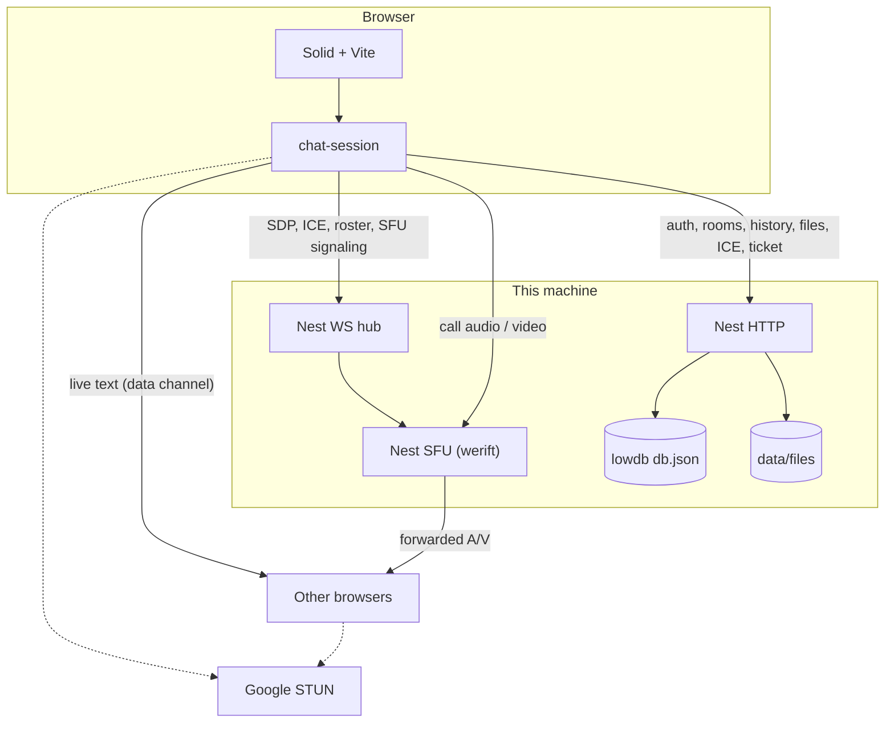

# Architecture

```
client/   Solid + Vite UI
server/   NestJS API and signaling WebSocket
shared/   Zod schemas and pure helpers
e2e/      Playwright
data/     local JSON database (gitignored)
docs/     this wiki
```

## System

Two planes, plus an SFU hop for calls. Solid talks to Nest over HTTP (auth, rooms, history, files, profile, ICE, ticket) and a ticketed WebSocket (SDP, ICE, inbox activity, call roster, SFU signaling). Live text prefers a WebRTC data-channel mesh. An open thread also refetches Nest history when signaling join lands and when it sees an activity frame, so messages still appear if the mesh is not up yet. Call audio and video go browser → Nest → browsers. Each caller has one `RTCPeerConnection` to Nest.



Solid edges are the control plane, persisted history, and the SFU upload. Dashed edges are STUN and peer ICE. Nest stores message bodies in `data/db.json` and file bytes in `data/files/`. Camera and mic are not sent to members who have not joined the call.

| Layer | Role | Does not do |
| --- | --- | --- |
| Solid + Vite | Views, session, text mesh, SFU link, local history cache | Authoritative persist |
| Nest HTTP | Auth, rooms, DMs, messages, files, profile, ICE, ticket | Push live text unsolicited |
| Nest WS | Join, SDP, ICE, activity (inbox + open-thread history pull), call roster + cap, SFU signaling | Inspect data-channel payloads |
| Nest SFU (werift) | One PC per caller; forward audio/video to other callers | Forward live text |
| lowdb | Profiles, rooms, messages, files, read cursors | Call media or concurrent writers |
| WebRTC mesh | Live text to the room | Call audio or video |

## Transport

| Path | Goes through Nest? |
| --- | --- |
| Signup, rooms, profile | Yes |
| Message history, unread | Yes (`data/db.json`) |
| Attachment bytes (file or folder zip) | Yes (`data/files/`; metadata in `db.json`) |
| Live text (when a peer is connected) | Also WebRTC data channel |
| Live text (open thread, mesh down) | Nest history refetch on activity |
| Call audio / video | Yes — Nest SFU forwards RTP; each caller uploads once |
| SDP / ICE / call roster / SFU signaling | Yes (`/ws`) |
| ICE servers (`GET /api/ice`) | Yes — used by the text mesh and each SFU uplink |

Sending a message POSTs it for history, then fans it out over the data channel when a peer is online. An open thread also refetches that history when signaling join lands and when it sees an activity frame. Inbox activity frames update unread and last-message without an open thread.

A/V uses a **selective forwarding unit** in Nest (`werift`). Each caller has one WebRTC connection to this server. Nest forwards that media to the other people in the call (cap `AV_MESH_CAP`, 16). Audio and video added in the same moment are offered together, and `sfu-route` mids are published after the SFU sets the local description. A caller that is still waiting for the SFU’s answer queues a later offer instead of rolling back. Live text still uses a peer-to-peer data-channel mesh. Call tiles keep the `<video>` muted (autoplay) and attach remote audio to a hidden `<audio>` element.

## Stack

Client: Vite (HTTPS in `npm run dev`), SolidJS, TypeScript, Tailwind  
API: NestJS, Passport Local + session cookie, lowdb  
Validation: Zod  
FP / reactive: fp-ts (pure), Effect (IO), RxJS (streams), Solid signals  
Quality: ESLint (complexity max 10), Husky, Vitest, Playwright
