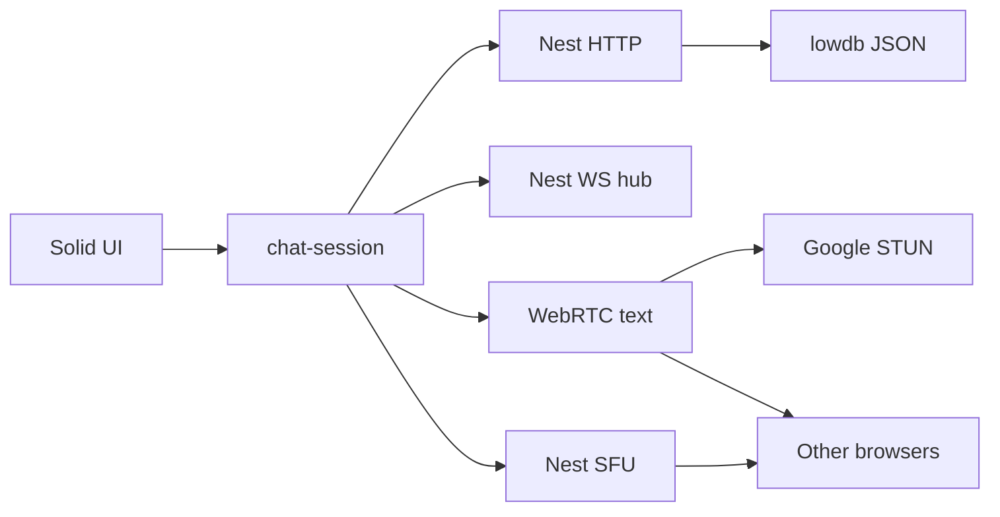
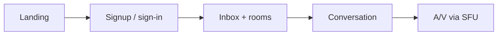

# chat-refine status

Late alpha. Snapshot of presence in the channel header plus a Connecting-peers relay hint and a coturn recipe on `develop`, 14 Sep 2026.

This page is the in-repo export of the Cursor project-status canvas. The live canvas is a local Cursor file (not in git). Anyone with the repo can read this markdown. Sequenced next work: [Roadmap](Roadmap.md).

On-prem peer-to-peer text plus Nest-forwarded call media. Nest handles auth, rooms, history, unread, files, signaling, and the SFU. Live text prefers a WebRTC data-channel mesh (no A/V on those peer connections); an open thread also refetches history on activity.

**Core loop is complete on `develop`.** Sign up, rooms and DMs (public Join or private invite), server-backed history with edit/delete, inbox unread plus jump-to-unread in the thread, attachments (file or folder from one Attach control), notifications (muted channels stay quiet), profile (bio, status, avatars, theme, visibility), Telegram-style people search, and calls that upload once to Nest. Werift forwards audio and video to other in-call peers. Channel header shows who is in the room. Hard NAT uses coturn via `ICE_SERVERS`. Production serve is not done.

| Maturity | Shared + server lines | Playwright e2e last push | SFU call cap |
| --- | --- | --- | --- |
| Late alpha | 90% | 14 / 14 | 16 peers |

## Architecture

Two planes, plus an SFU hop for calls. Solid talks to Nest over HTTP (auth, rooms, history, files, profile, ICE, ticket) and a ticketed WebSocket (SDP, ICE, inbox activity, call roster, SFU signaling). Text still goes browser-to-browser. Call media goes browser to Nest to browsers. Full diagram: [Architecture](Architecture.md).

Solid lines in the canvas: control plane, persisted history, and the SFU upload. Dashed: WebRTC candidates, P2P text, and forwarded call tracks. Nest stores message bodies in `data/db.json` and file bytes in `data/files/`. Each caller has one `RTCPeerConnection` to Nest.

| Layer | Role | Does not do |
| --- | --- | --- |
| Solid + Vite | Views, session, text mesh, SFU link, local history cache | Authoritative persist |
| Nest HTTP | Auth, rooms, DMs, messages, files, profile, ICE, ticket | Push live text unsolicited |
| Nest WS | Join, SDP, ICE, activity (inbox + open-thread history pull), call roster + cap, SFU signaling | Inspect data-channel payloads |
| Nest SFU (werift) | One PC per caller; forward audio/video to other callers | Forward live text |
| lowdb | Profiles, rooms, messages, files, read cursors | Call media or concurrent writers |
| WebRTC mesh | Live text to the room (data channel only) | Call audio or video |

## What ships today

18 of 20 product surfaces shipped.

| Surface | State | Limit |
| --- | --- | --- |
| Signup / sign-in / sign-out | Done | Username + password only |
| Groups, DMs, directory | Done | Public Join; private invite; owner + member |
| P2P text + server history | Done | Edit/delete own messages; localStorage cache |
| Inbox unread + last message | Done | Jump to unread in the open thread |
| Attachments (file or folder) | Done | One Attach control; bytes on disk; no size cap |
| Profile, avatars, preferences | Done | 36 catalog avatars or upload; theme + visibility |
| Notify | Done | Notifications are opt-in |
| A/V join, mute, camera | Done | Media through Nest SFU, cap 16 |
| Nest SFU (werift) | Done | Coalesced A/V offers; queued renegotiation; cap 16 |
| Mobile stack + markdown | Done | Bold, italic, code, http(s) links |
| Presence + members | Done | Header avatars; here = open thread |
| Internet ICE | Done on develop | STUN default; coturn via `ICE_SERVERS`; stall hint |
| In-repo wiki (`docs/`) | Done | Native GitHub Wiki locked on private free plan |
| Production single process | Not wired | Nest does not yet serve `client/dist` |
| Promote develop to main | Not done | `main` is 86 commits behind `742b91c` |

## UX

Landing, auth, an inbox-style directory, a thread, and an optional call stage. The room list shows unread and last message. The call stage only appears when someone is in the call. Join call attaches camera and mic to Nest, not to every other peer.

### Works well

| Flow | Detail |
| --- | --- |
| Directory | Unread bold + badge (muted stays quiet), last message, `#` channels, DMs, create, private, find |
| Thread | Slack-like left-aligned + grouped bursts, boxed composer, Attach, search, New messages divider, edit/delete, topic, member avatars |
| Call | Join / mute / camera / leave; SFU + roster + cap 16; remote video autoplays |
| Profile | Bio, status, 36 avatars or upload, theme, visibility |
| Notify | Opt-in desktop alerts while another tab is focused |
| Phone | Rooms first; thread + Rooms back link |

### Friction

| Gap | Why it hurts |
| --- | --- |
| Hard NAT | STUN fails on symmetric NAT; run coturn and set `ICE_SERVERS` |
| Self-signed Vite cert | Accept it once so LAN Join call can open camera/mic |
| `main` behind `develop` | Production tag is rooms/signaling only |
| lowdb JSON | One process; not durable under concurrent writers |
| GitHub Wiki pages | Private free-plan repo cannot enable Wikis |

## Code quality

Shared and server stay behind the V8 gate. Client mesh helpers and SFU lock helpers have unit tests; full `RTCPeerConnection` behavior is still Playwright. Coverage is local HTML under `coverage/`, shared + server only. `sfu-room.ts` fan-out is lightly covered; the two-caller path is e2e.

### Shared + server V8 coverage vs fail thresholds

Source: local Vitest V8 · 14 Sep 2026. Client `mesh.ts` and `sfu-link.ts` are excluded from the gate. 140 unit/API tests, 14 Playwright specs.

| Metric | Measured % | Fail threshold % |
| --- | --- | --- |
| Lines | 89.33 | 80 |
| Statements | 89.33 | 80 |
| Functions | 88.23 | 80 |
| Branches | 84.59 | 70 |

| Practice | How it shows up |
| --- | --- |
| Contracts in `shared/` | Zod for auth, rooms, messages, ICE, signaling, call roster, SFU frames |
| Hooks | pre-commit Vitest; pre-push Playwright (14 specs, HTTPS Vite, ignore self-signed cert) |
| Complexity | ESLint complexity max 10 |
| Git Flow | `develop` is integration; `main` is 86 commits behind; no leftover feature branches |
| Docs | README and `docs/` update in the same change as the code |
| Security posture | Argon2 passwords; session cookie; default `SESSION_SECRET` fallback in create-app |

## Complexity

The hard parts shifted. Text mesh is still perfect negotiation. Call media is now a Nest SFU with per-caller offer serialization so concurrent audio and video cannot crash the process.

| Area | Heat | Why |
| --- | --- | --- |
| `server/src/signaling/sfu-room.ts` | High | Answer, fan-out, retract, exclusive offer queue |
| `client/src/lib/sfu-link.ts` | High | One PC to Nest, queued offers, mid-to-user routes |
| `client/src/lib/chat-session.ts` | High | History, inbox, roster, SFU attach vs text mesh |
| `client/src/lib/mesh.ts` | Medium | Data-channel perfect negotiation and ICE queue |
| Auth, wiki, pages | Low | Straightforward Nest + Solid + `docs/` |

**Paradigm density.** fp-ts (pure data), Effect (IO), RxJS (streams), and Solid signals (view) stay in those lanes. Room and auth writes append/replace arrays instead of mutating rows in place. Signaling and inbox subscribe with RxJS. The remaining risk is `RTCPeerConnection` edge cases that only Playwright hits, plus SFU offer glare if the pending-offer queue is bypassed.

## Roadmap

Sequenced in [Roadmap](Roadmap.md). Now is friction that blocks real use. Slack-like completeness shipped. Later is ops if the install outgrows one process. Do not promote `develop` to `main` until production serve is decided.

### Now

| Work | Why |
| --- | --- |
| Production serve | Nest serves `client/dist`, HTTPS, secure cookies, required secret |
| Release to `main` | Only after production shape is chosen |

### Next

Shipped: jump to unread, thread search, edit/delete, private invite, topic, mute channel.

### Later

| Work | Why |
| --- | --- |
| SQLite (or similar) | lowdb is one process |
| Native GitHub Wiki | Locked on a private free-plan repo |

Shipped work (history, inbox, SFU, HTTPS Vite, Slack-like thread, people search) stays closed. Full checklist: [Roadmap](Roadmap.md).

## Git

This change: presence in the channel header, a relay hint when ICE stalls, and a coturn Docker recipe for `ICE_SERVERS`. Parent `develop` was `742b91c`. README and `docs/` are updated in the same change as the code. `main` stopped at rooms/signaling (PR #4). Remote heads are only those two branches. Next release decision is whether to promote `develop` to `main` after production serve.
