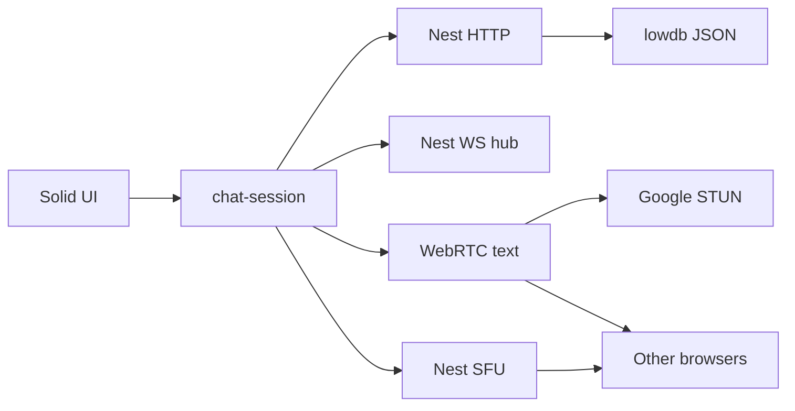
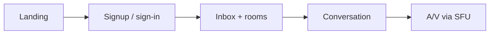

# chat-refine status

Late alpha. Snapshot of `develop` @ `affc427`, 13 Sep 2026.

This page is the in-repo export of the Cursor project-status canvas. The live canvas is a local Cursor file (not in git). Anyone with the repo can read this markdown.

On-prem peer-to-peer text plus Nest-forwarded call media. Nest handles auth, rooms, history, unread, files, signaling, and the SFU. Live text stays on a WebRTC data-channel mesh.

**Core loop is complete on `develop`.** Sign up, rooms and DMs, server-backed history, inbox unread, small files, notifications, profile edit, and calls that upload once to Nest. Werift forwards audio and video to other in-call peers. `main` is still 33 commits behind (rooms/signaling only). Production serve and TURN are not done.

| Maturity | Shared + server lines | Playwright e2e last push | SFU call cap |
| --- | --- | --- | --- |
| Late alpha | 89% | 9 / 9 | 16 peers |

## Architecture

Two planes, plus an SFU hop for calls. Solid talks to Nest over HTTP (auth, rooms, history, files, profile, ICE, ticket) and a ticketed WebSocket (SDP, ICE, inbox activity, call roster, SFU signaling). Text still goes browser-to-browser. Call media goes browser to Nest to browsers.

Solid lines in the canvas: control plane, persisted history, and the SFU upload. Dashed: WebRTC candidates, P2P text, and forwarded call tracks. Nest stores message bodies and small files in `data/db.json`. Each caller has one `RTCPeerConnection` to Nest.

| Layer | Role | Does not do |
| --- | --- | --- |
| Solid + Vite | Views, session, text mesh, SFU link, local history cache | Authoritative persist |
| Nest HTTP | Auth, rooms, DMs, messages, files, profile, ICE, ticket | Relay live text |
| Nest WS | Join, SDP, ICE, activity, call roster + cap, SFU signaling | Inspect data-channel payloads |
| Nest SFU (werift) | One PC per caller; forward audio/video to other callers | Forward live text |
| lowdb | Profiles, rooms, messages, files, read cursors | Call media or concurrent writers |
| WebRTC mesh | Live text to the room | Call audio or video |

## What ships today

15 of 20 product surfaces shipped.

| Surface | State | Limit |
| --- | --- | --- |
| Signup / sign-in / sign-out | Done | Username + password only |
| Groups, DMs, directory | Done | No invites or roles |
| P2P text + server history | Done | Also cached in localStorage |
| Inbox unread + last message | Done | Activity frames, no open thread needed |
| Files / images (~1 MB) | Done | Stored on this server |
| Notify + profile (name, avatar) | Done | Notifications are opt-in |
| A/V join, mute, camera | Done | Media through Nest SFU, cap 16 |
| Nest SFU (werift) | Done | Serialized offers; one upload per caller |
| Mobile stack + markdown | Done | Bold, italic, code, http(s) links |
| Internet ICE (Google STUN) | Done on develop | Hard NAT still needs TURN |
| In-repo wiki (`docs/`) | Done | Native GitHub Wiki locked on private free plan |
| Production single process | Not wired | Nest does not yet serve `client/dist` |
| Promote develop to main | Not done | `main` is 33 commits behind |

## UX

Landing, auth, an inbox-style directory, a thread, and an optional call stage. The room list shows unread and last message. The call stage only appears when someone is in the call. Join call attaches camera and mic to Nest, not to every other peer.

### Works well

| Flow | Detail |
| --- | --- |
| Directory | Unread, last message, rooms, DMs, create, find |
| Thread | Server history, files, Enter to send, typing |
| Call | Join / mute / camera / leave; SFU + roster + cap 16 |
| Profile | Click your name; display name and avatar |
| Notify | Opt-in desktop alerts while another tab is focused |
| Phone | Rooms first; thread + Rooms back link |

### Friction

| Gap | Why it hurts |
| --- | --- |
| Connecting peers… | STUN fail on symmetric NAT; no TURN wizard |
| HTTPS for camera | Needed off localhost |
| `main` behind `develop` | Production tag is rooms/signaling only |
| lowdb JSON | One process; not durable under concurrent writers |
| No edit / delete / invites | Messages and memberships are append-only |
| GitHub Wiki pages | Private free-plan repo cannot enable Wikis |

## Code quality

Shared and server stay behind the V8 gate. Client mesh helpers and SFU lock helpers have unit tests; full `RTCPeerConnection` behavior is still Playwright. Coverage is local HTML under `coverage/`, shared + server only. `sfu-room.ts` fan-out is lightly covered; the two-caller path is e2e.

### Shared + server V8 coverage vs fail thresholds

Source: local Vitest V8 · 13 Sep 2026. Client `mesh.ts` and `sfu-link.ts` are excluded from the gate. 101 unit/API tests, 9 Playwright specs.

| Metric | Measured % | Fail threshold % |
| --- | --- | --- |
| Lines | 89.47 | 80 |
| Statements | 89.47 | 80 |
| Functions | 88.79 | 80 |
| Branches | 87.77 | 70 |

| Practice | How it shows up |
| --- | --- |
| Contracts in `shared/` | Zod for auth, rooms, messages, ICE, signaling, call roster, SFU frames |
| Hooks | pre-commit Vitest; pre-push Playwright (9 specs) |
| Complexity | ESLint complexity max 10 |
| Git Flow | `develop` is integration; `main` is 33 commits behind; no leftover feature branches |
| Security posture | Argon2 passwords; session cookie; default `SESSION_SECRET` fallback in create-app |

## Complexity

The hard parts shifted. Text mesh is still perfect negotiation. Call media is now a Nest SFU with per-caller offer serialization so concurrent audio and video cannot crash the process.

| Area | Heat | Why |
| --- | --- | --- |
| `server/src/signaling/sfu-room.ts` | High | Answer, fan-out, retract, exclusive offer queue |
| `client/src/lib/sfu-link.ts` | High | One PC to Nest, polite rollback, mid-to-user routes |
| `client/src/lib/chat-session.ts` | High | History, inbox, roster, SFU attach vs text mesh |
| `client/src/lib/mesh.ts` | Medium | Text-only perfect negotiation and ICE queue |
| Auth, wiki, pages | Low | Straightforward Nest + Solid + `docs/` |

**Paradigm density.** fp-ts (pure), Effect (IO), RxJS (streams), and Solid signals all appear. That raises onboarding cost. The remaining risk is `RTCPeerConnection` edge cases that only Playwright hits, plus SFU offer glare if the exclusive queue is bypassed.

## Possible improvements

- [x] Server-backed history so inbox, unread, and other devices stay in sync
- [x] Unread, last message, notifications, file drops, profile edit
- [x] A/V among in-call peers (first as mesh, now replaced by SFU)
- [x] In-repo wiki under `docs/` (native GitHub Wiki still locked)
- [x] Unit-test mesh-media helpers (full `RTCPeerConnection` still e2e-only)
- [x] Nest SFU: one upload per caller, werift forward, cap 16
- [ ] Release: merge `develop` into `main` so production matches history, inbox, and SFU calls
- [ ] Production shape: Nest serves `client/dist`, HTTPS, secure cookies, required `SESSION_SECRET`
- [ ] Documented TURN path plus a clearer Connecting-peers failure
- [ ] Replace lowdb with SQLite if more than one process or real durability is needed

## Git

`develop` @ `affc427` has inbox, wiki, the Nest SFU, and a standing rule to refresh status after every change. `main` stopped at rooms/signaling (PR #4), 33 commits behind. Remote heads are only those two branches. Next release decision is whether to promote `develop` to `main`.
